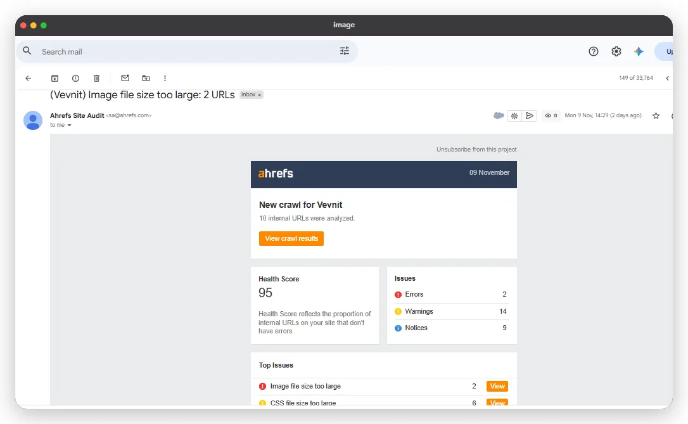
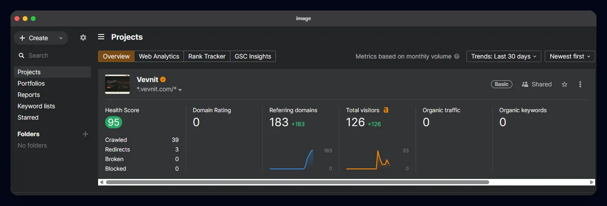
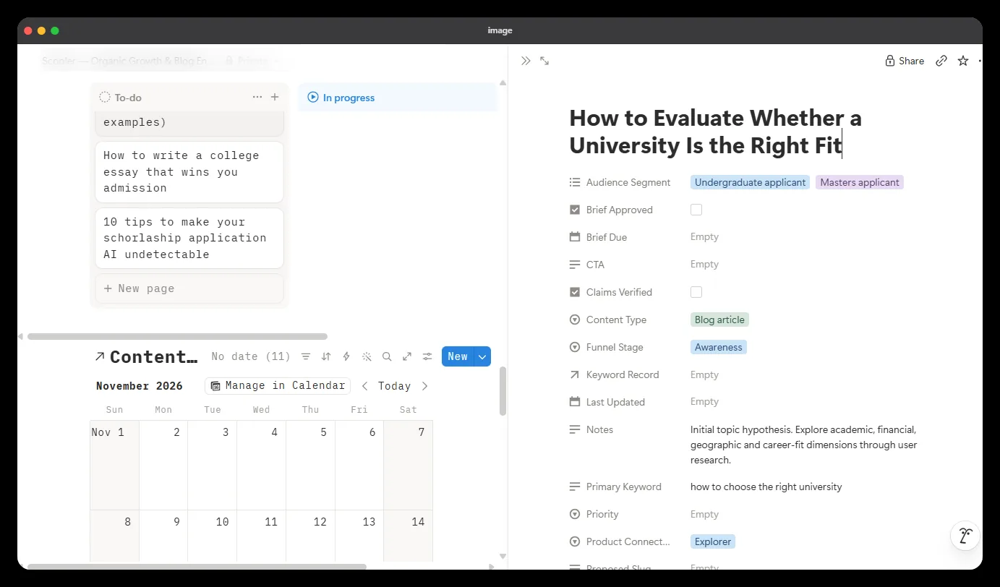
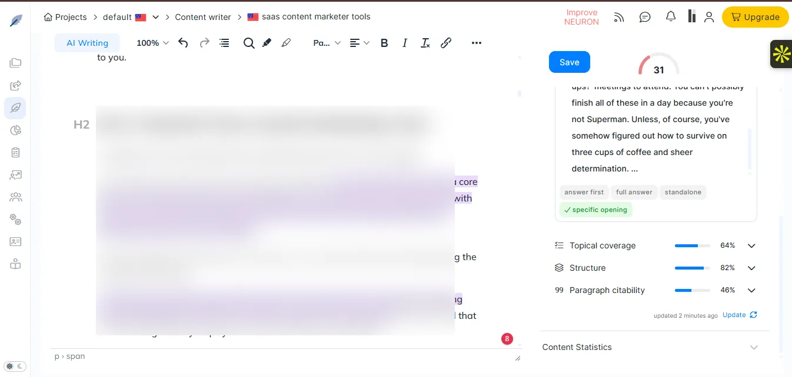
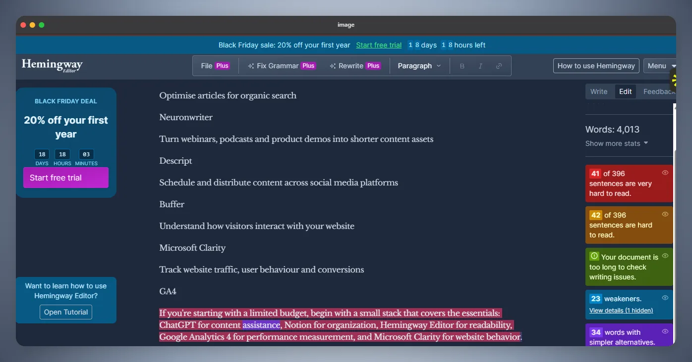
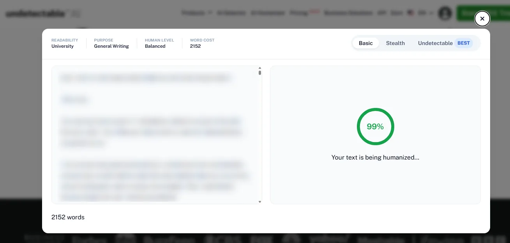
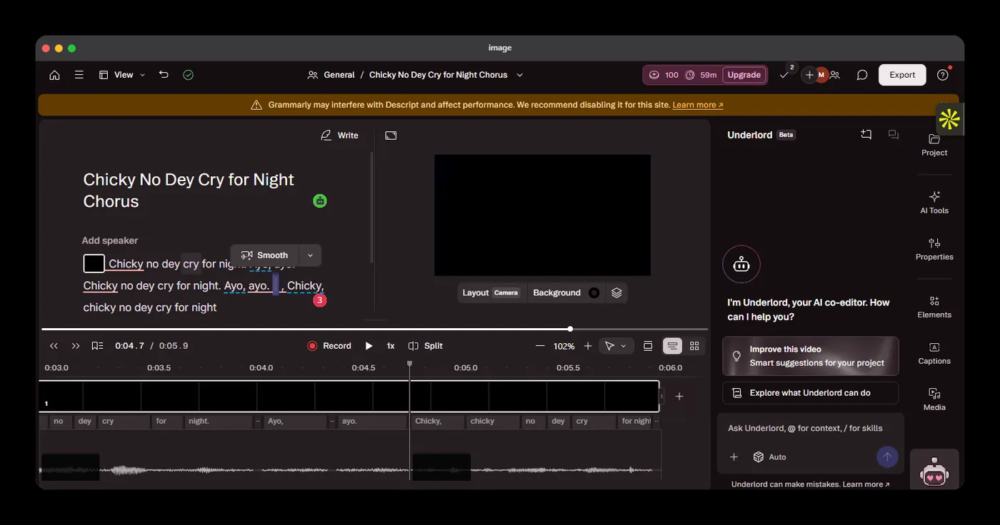
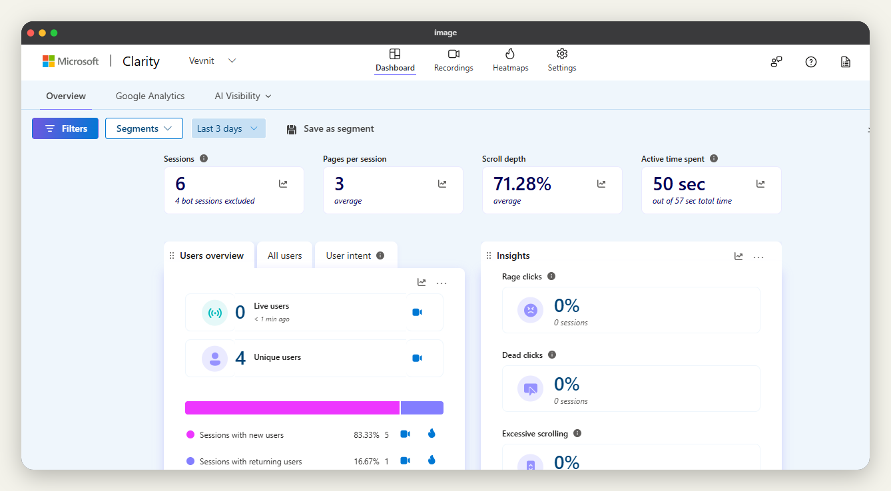

## TL;DR

- **Research:** Ahrefs for keywords and competitors; Apify for audience insights.
- **Plan:** Notion for your calendar and project files.
- **Create:** ChatGPT for ideas and drafts; Descript for turning video and audio into short content.
- **Optimize:** Neuronwriter for SEO; Hemingway Editor for readability.
- **Distribute:** Buffer for scheduling.
- **Measure:** Google Analytics 4 (GA4) for traffic and conversions; Microsoft Clarity for visitor behavior.
- **If you're on a tight budget** Start with ChatGPT, Notion, Hemingway, GA4, and Clarity. Their free tiers can cover much of the essential workflow.

This is you.

You wake up, head to your workstation, and turn on your PC to start the day’s work. Then it hits you: you have a bunch of unticked boxes on your to-do list.

First, you have keyword research to do, a content audit to finish, an SEO draft to write, the sales team to interview, an existing article to repurpose and, of course, the dreadful “Why is content not driving enough sign-ups?” meetings to attend.

You cannot possibly finish all of these in a day because you are not superhuman. Unless, of course, you have somehow figured out how to survive on three cups of coffee and sheer determination.

Realistically, how do you clear all of this from your plate without sacrificing quality, spending all your time at work or losing the joy of doing good work?

That is what this article is about: the right tool stack for solo SaaS content marketers across research, content strategy, production, SEO optimization, distribution, and performance measurement.

## Quick glance at the top SaaS content marketing tools

| Tool | Best for | Trade-off | Workflow stage | Starting cost |
| ------------------ | ------------------------------------------------------------------------------------- | --------------------------------------------------------------------- | ------------------------------------------- | ------------------------- |
| Ahrefs | SEO research, backlinking, link prospecting, website audits and content opportunities | Does not include PPC, SMM or a complete content optimisation suite | SEO research | $29 |
| Apify | Collecting audience and other raw data across the web | Extracted data requires cleaning and analysis | Audience research | Free; paid from $19/month |
| ChatGPT | Brainstorming, research assistance, drafting, editing and everyday content tasks | Requires human judgement, context and fact-checking | AI assistance | Free; paid from $8/month |
| Notion | Editorial calendars, content repositories, projects and documentation | Flexible but requires setup; can have a learning curve | Content planning and productivity | Free |
| Hemingway Editor | Improving readability, identifying wordy sentences and editing content | Readability suggestions can oversimplify technical content | Content editing | Free |
| Neuronwriter | Optimising articles and landing pages for organic search | Content scores can encourage over-optimisation if followed blindly | SEO content optimisation | $23/month |
| Undetectable AI | Reworking AI-written content to improve its flow and phrasing | Does not guarantee undetectability | Content refinement | $19/month |
| Descript | Turning webinars, podcasts, interviews and product demos into shorter content | Less suitable for complex professional video production | Content repurposing | $16/month |
| Buffer | Scheduling and distributing content across social platforms | Limited social listening and competitor intelligence | Social distribution | Free |
| Microsoft Clarity | Understanding visitor behaviour through heatmaps and session recordings | Requires time to review recordings and interpret behavioural patterns | Website behaviour analytics | Free |
| Google Analytics 4 | Measuring website traffic, user interactions, and conversion events | Does not provide comprehensive SEO analysis | Content performance and conversion tracking | Free |

*Prices and the figures used in this article's comparison and may change. Check each provider's pricing page before purchasing.*

## What “scale output” really means

In this context, scaling output means increasing the volume of content you research, create, optimise and distribute within a given period, without increasing your workload. It is about getting more work done with the time and resources available to you.

## How I selected these content marketing tools

I mapped out the content lifecycle and picked the best tool for each stage.

I also made sure the tools fit a solo content marketer. As such, they have to solve a core part of your job, offer enough technical depth across their features, integrate well with other tools and be easy enough to use that you do not have to spend another day learning how they work on YouTube.

I also prioritized tools that give you value for your money rather than simply picking the cheapest alternatives.

I have used some of these tools myself. For the ones I have not, I spent time digging through subreddits for real users’ reviews, product documentation, and demos. Every tool on the list should help you do more with less manual effort.

## The best tools for every stage of the SaaS content marketing workflow

### 1 Ahrefs: best for SEO research and content discovery

Ahrefs is my go-to for understanding the organic performance of a website.

I use the free Site Explorer and Site Audit for my new content studio website. If you verify website ownership with Ahrefs, you get access to a limited free version of these tools, although you may eventually need a paid plan.

For me, it is helpful when I want to know how my website is performing across useful metrics, so I know what to focus on to grow the site.

I turned on the Always-On Audit so I receive email alerts when a new technical issue is detected on my site.

*An Ahrefs Site Audit alert highlighting a technical issue that needs attention.*

The Site Explorer tool makes you feel like a space satellite. It gives you comprehensive data on any website. All you need to do is input your competitors to see how they perform in terms of Domain Rating (DR), backlinks, site structure and other important data.

*A snapshot of the Ahrefs project overview and its core website metrics.*

I then move to Content Explorer to find top-performing content in a niche and identify content opportunities competitors might have missed.

In Keyword Explorer, add a seed keyword, and you get a deep sea of topics. The results can be overwhelming, so I filter for keyword difficulty (KD) of 0–20 and 100–1,000 monthly searches. That range gives me topics a newer site can realistically rank for, with enough demand to be worth the effort. As the site's authority grows, I raise the KD ceiling.

#### Ahrefs pros and cons

**Pros**

- Runs comprehensive keyword and backlink research.
- Allows you to set up regular audits and receive email alerts.
- Website owners can verify their sites and access a limited version of Site Explorer and Site Audit for free.

**Cons**

- The extensive data can be overwhelming without a clear research objective.
- Useful tools are restricted on lower plans, so you may need to upgrade to unlock them.

#### Ahrefs pricing

- Free Ahrefs Webmaster Tools
- Starter: $29/month
- Lite: $129/month
- Standard: $249/month
- Advanced: $449/month

#### Ahrefs alternative for solo content marketers in SaaS

If you work with B2C SaaS companies that typically run multi-channel marketing across PPC, social media, SEO, and AI visibility, Semrush is worth considering. But if you primarily focus on organic search, deep backlink analysis, keyword research, competitor gaps, and content opportunities, Ahrefs is a strong fit.

### 2 Apify: best for collecting raw data across the web

Apify scrapes websites and social media to help you gather qualitative insights from across the internet.

Whenever I need to collect information from the web, I use a pre-built Actor to extract the information I need about an audience, a competitor, or a topic. You can use Actors to collect public discussions, questions, comments, reviews, customer feedback, and pain-point queries in an industry. The Apify Store lists a large library of pre-built tools.

For instance, I once used a pre-built Instagram Scraper to analyse a competitor’s social media activity. I extracted its posts, engagement metrics, captions, and posting patterns to understand how it approached content.

One thing to know, though, is that Apify’s extracted data can be messy. I usually upload the results to Claude to organize the information, identify patterns, and develop actionable insights. Alternatively, you can connect Apify to an AI assistant through its MCP server and run Actors directly from your everyday AI tool.

For a solo SaaS content marketer, this means you can investigate what potential customers are discussing, the problems they encounter with existing solutions, and the questions they ask online. You can then use those findings to inform your content strategy.

#### Apify pros and cons

**Pros**

- Offers a large library of pre-built tools to scrape website data and social media.
- Useful for social listening, audience research, and content ideation.
- Connects with everyday AI tools through MCP.

**Cons**

- Extracted data requires substantial cleaning before it becomes useful.
- Its usage-based pricing model can make costs unpredictable when running large-scale scraping.
- Requires some learning to identify reliable Actors and configure them properly.

#### Apify pricing

- Free, no credit card required.
- Starter: $19.
- Scale: $199.
- Business: $999.

### 3 Notion: best for content planning and productivity

I have learned not to lose track of new ideas again. I use Notion for practically everything: a content calendar, a simple Kanban CRM, and a repository for new projects I am taking on.

Since I connected its MCP integration with ChatGPT, I can capture my thoughts and ideas as they come through voice messages. I pour out the ideas as they occur, then ask ChatGPT to create a file for them in Notion and keep everything organized. If I need a reminder, I set a date for it.

For work, I create full brand guidelines, documentation, editorial calendars, project trackers, project repositories, and simple CRM systems.

*A Notion editorial calendar for organising content and keeping projects on track.*

Whenever I need to work on a new account, I populate my Notion workspace with the necessary information. That way, when I need to get a task done with ChatGPT, I can attach the relevant Notion project file instead of repeatedly providing the same background context.

#### Notion pros and cons

**Pros**

- Customise the workspace to build a CRM, calendar, templates, tables and boards.
- Collaborate with others in your workspace.
- The free plan is generous for a single user.
- Connects to the AI tools you use every day for work.

**Cons**

- Limited offline functionality compared with local-first applications such as Obsidian.
- A steep learning curve when building tools from scratch.

#### Notion pricing

- Free.
- Plus: $12.
- Business: $24.

### 4 ChatGPT: best for a general-purpose AI assistant

Sometimes, I wonder how solo content marketers went about their business before November 2022. It almost seems impossible to get through everyday tasks without ChatGPT on the side.

I think the tool is almost a full-time assistant for everyone now. I use ChatGPT to validate content ideas, write the first draft, edit, and bounce ideas around. It would be redundant to walk you through the everyday use of ChatGPT again.

#### ChatGPT pros and cons

**Pros**

- An entry-level assistant for everyday content marketing tasks.
- Can connect with other tools and services to support more involved workflows.

**Cons**

- Can produce generic content that lacks original insight or industry depth. Claude may be a better choice for some of these tasks.
- Requires human verification and editorial judgement.
- Does not replace specialist tools for SEO, analytics, publishing and distribution.

#### ChatGPT pricing

- Free tier.
- Go: $8/month.
- Plus: $20/month.
- Pro: $100/month.

### 5 Neuronwriter: best for SEO content optimisation

Neuronwriter helps you optimise articles and landing pages for search engines, giving your content a better chance of competing in organic search results.

It analyses top-ranking Google search results based on your target keyword to identify what competitors are covering. It also makes keyword suggestions for relevant terms, questions and topics you can incorporate into your content. It suggests outlines to help you cover a topic thoroughly.

As you write, Neuronwriter gives your draft a real-time content score based on how well you include recommended terms, structure your headings (H1, H2, and H3), and meet target word counts. You can also explore its AI tools to generate content, outlines, and FAQs.

*Neuronwriter's optimisation workspace for reviewing topical coverage and on-page recommendations.*

Beyond traditional SEO, Neuronwriter has an AI Visibility feature that lets you monitor how often your brand appears in AI-generated answers and whether your website is cited as a source.

#### Neuronwriter pros and cons

**Pros**

- Optimises content for SEO based on pages that already rank.
- Tracks how your brand or content gets cited across AI answer engines such as ChatGPT, Perplexity and Gemini.
- Relatively affordable compared with alternatives such as Surfer SEO and Clearscope.
- Includes AI writing and content-planning features.

**Cons**

- Content scores can encourage over-optimisation if followed blindly.
- AI visibility monitoring across ChatGPT and Perplexity may require additional access beyond standard plan inclusions.
- Some integrations and advanced features are restricted to higher-tier plans.

#### Neuronwriter pricing

| Plan | Price |
| -------- | ---------- |
| Bronze | $23/month |
| Silver | $45/month |
| Gold | $69/month |
| Platinum | $93/month |
| Diamond | $117/month |

### 6 Hemingway Editor: best for content editing

I take every piece of my work through Hemingway, and you should too if you do not have the luxury of an editor.

Hemingway helps ensure your writing is concise and easy to read. Your content is assessed for readability, sentence complexity, verbosity, and how easy it is to scan.

All you need to do is paste your draft, and it immediately highlights areas that need attention. I also use Grammarly, but it is more useful for spotting grammar, spelling, punctuation and other writing issues.

*Hemingway Editor flags sentences that may need simplifying during the editing process.*

Hemingway is what I use in my editing process because the free version gets me halfway through the process. If you need additional features such as AI rewriting, document uploads and more advanced editing capabilities, you can upgrade to its paid version.

#### Hemingway pros and cons

**Pros**

- Generous free plan.
- Does a good job of spotting readability issues and wordy sentences.

**Cons**

- Suggestions can oversimplify writing and strip away context, particularly in complex content.

#### Hemingway pricing

- Free.
- Paid: $20.

### 7 Undetectable AI: for rewriting AI-generated content

As writers, the truth is that sometimes we do not want to write. But you still have deadlines to meet and deliverables to submit. Undetectable AI could fit into your workflow.

Sometimes, you already have the idea and a clear direction for a particular script, article or copy. You know the tone, structure, arguments, and points you want to communicate, but you are probably too busy (or, truthfully, too lazy) to sit down and type everything into Google Docs.

Here is what you could do on those days: record a voice message to ChatGPT or Claude explaining everything you want in the first draft. Make sure the direction, tone, structure, ideas and argument you want to explore are clear enough.

Depending on how the first draft comes out, either provide more context and annotate it or, if it is good enough, move it to Undetectable AI to rewrite and refine it.

*An example of an AI-assisted rewriting workflow. Always review the output for accuracy, meaning and voice.*

However, my stance on AI writing is that it will not ever get everything right. It is better to write the larger part of a first draft yourself and use AI to improve it than to depend on it to produce a piece from scratch. Or, a better way to use an AI-generated draft is to rely on it strictly for short-form content where you can more easily manage the lack of a human touch.

#### Undetectable AI pros and cons

**Pros**

- Rewrites AI-generated sentences for better flow, phrasing and readability.
- Offers tone and writing-style adjustment options.
- Combines AI detection and text rewriting in one platform.

**Cons**

- Can rewrite and distort your original meaning, tone and argument.
- Requires human editing and fact-checking before publication.
- Does not guarantee undetectability.

#### Undetectable AI pricing

- $19/month for 20,000 words.
- $31/month for 35,000 words monthly.
- $42/month for 50,000 words monthly.
- $64/month for 80,000 words monthly.

### 8 Descript: best for video and audio repurposing

Descript helps you turn webinars, product demos, interviews, and podcasts into shorter content that you can distribute for optimum results.

One thing that makes Descript interesting is its transcription-based editing workflow. Instead of working entirely on a traditional video timeline, you edit your footage by editing its transcript. You can delete sentences, remove unnecessary sections, and rearrange parts of a recording by making changes to the text.

The tool also makes it easier to remove filler words, generate captions, improve audio quality, and translate or dub content into different languages. You can use its AI features, called Underlord, to find interesting parts of long videos and create shorter versions for social media audiences.

*Descript's transcript-based editing workflow makes it easier to turn long recordings into shorter content.*

For instance, imagine your SaaS company has just hosted a one-hour webinar on how businesses can automate their procurement processes. Instead of letting the recording sit on YouTube, you can import it into Descript, generate a transcript, dub it into multiple languages depending on your market, create hook-strong short clips for social media or use the transcript for a blog post.

In more ways than one, it is useful when you are responsible for producing and distributing multiple pieces of content across different formats without adding a video editor to your job title.

#### Descript pros and cons

**Pros**

- Makes video editing easier.
- Improves audio quality, removes background noise, filler words and clicks.
- Makes it easier to turn one video into multiple formats, including language dubbing and translation.

**Cons**

- Some features are credit-based, and high-volume users may use credits before they expire.
- Not built for high-end production and complex creative work.
- Some advanced capabilities are restricted to higher subscription tiers.

#### Descript pricing

- Hobbyist: $16/month.
- Creator: $24/month.
- Business: $50/month.

### 9 Buffer: best for social media distribution and scheduling

What makes Buffer stand out is its simplicity. It offers a clean, intuitive interface for planning, scheduling and publishing content across platforms such as LinkedIn, X, Facebook, Instagram, Pinterest, TikTok, Threads and YouTube Shorts.

You can write a post once and customise it for different platforms without starting from scratch each time. Buffer has separate editing fields for each social network. This lets you adjust the text, format and media for each platform. Its AI Assistant can also help you generate and refine social media content.

The scheduling and analytics features are useful, too. You can organise posts using a content calendar, schedule them in advance, and monitor available engagement metrics. Buffer also suggests the best times to post based on audience engagement patterns.

However, Buffer is not a comprehensive social media intelligence tool. It does not provide the detailed social listening and competitor analysis you may need. This may limit your ability to build an advanced social media strategy. Its analytics and community management features also vary across platforms and subscription plans.

If you need a more comprehensive social media management platform, Hootsuite is worth considering. It offers a broader set of capabilities, including social listening, engagement management, and analytics. But that additional functionality may be unnecessary if your primary requirement is simply to plan and schedule content.

#### Buffer pros and cons

**Pros**

- Manage multiple social media platforms from one dashboard.
- The free plan allows you to connect up to three social media platforms.
- Includes an AI Assistant for creating and repurposing social media content.
- Provides content scheduling, calendar management, and analytics.
- Allows you to organise content ideas and drafts.

**Cons**

- Some advanced analytics and publishing features require a paid plan.
- Pricing depends on the number of channels added.
- Platform-specific publishing limitations may require manual notifications or adjustments.

#### Buffer pricing

- Free: $0, up to three channels.
- Essentials: from $6/month.
- Team: from $12/month.

These are the base prices for running one social media channel on Buffer. Buffer charges per channel, so the total changes as you add more. Its pricing page lets you see the exact cost for the number of channels you need.

### 10 Microsoft Clarity: best for website behaviour analytics

Clarity is a behavioural analytics tool that helps you understand how people interact with your website. Its dashboard makes it easier to investigate user experience through its core features: heatmaps and session recordings.

Heatmaps show you where visitors click, how far they scroll, and which sections of a page receive the most attention. Session recordings let you replay individual user journeys to see how visitors navigate your website, where they hesitate, and where they encounter difficulties.

For instance, imagine you have published a detailed article with a CTA encouraging readers to book a product demo. Your GA4 report might show that the page receives traffic but generates very few conversions. With Clarity, you can investigate further. Are visitors scrolling far enough to see the CTA? Are they clicking on other elements instead? Are they abandoning the page before reaching the offer?

You can also identify behaviours such as rage clicks (repeated clicks on an element that is not responding) and dead clicks (clicks on elements that do not produce an expected action). These can help you decide how to improve your website.

One advantage is that Microsoft Clarity is free. You get access to heatmaps, session recordings, behavioural insights, and integrations with Google Analytics without paying for a subscription.

#### Microsoft Clarity pros and cons

**Pros**

- Free access to heatmaps and user session recordings.
- You can combine its behavioural insights with conventional website analytics.
- AI summaries can help you understand how users are interacting with your website.

**Cons**

- Session recordings require time to review and interpret.
- Requires appropriate privacy, consent, and data-masking configuration.

#### Microsoft Clarity pricing

- Free: $0. Microsoft offers its Clarity features without a paid subscription.

### 11 Google Analytics 4: best for content performance and conversion tracking

Remember the dreadful meetings I talked about in the introduction? Most content marketers can relate to that. But it does not have to be dreadful again, and that is where Google Analytics 4 saves the day.

GA4 is what I use when I need to understand how customers find my page, how they interact with content, what they click, and whether they perform the required conversion actions. I find it very useful because it is free, and I can get granular data that Google Search Console does not provide. I use the tools together.

Whenever I have a campaign to launch, I create UTM links, set up the relevant events in GA4, and monitor the landing page to understand where visitors come from, how they behave, and whether they are taking the actions I want. From there, I know what is working, what to tweak, and where to stop putting energy.

If you want to use GA4, I would advise spending time learning how to configure it properly. Some events and conversion actions need to be set up manually, and you may need to integrate GA4 with other tools to get the comprehensive data you need.

#### GA4 pros and cons

**Pros**

- Free access to extensive website analytics and conversion-tracking features.
- Collects first-party website and app interaction data.

**Cons**

- Requires configuration of events and key events for meaningful conversion tracking.
- Has a learning curve, particularly when building custom reports and explorations.

#### GA4 pricing

- Free.
- Google Analytics 360: paid enterprise offering.

## Quick picks: content marketing tools based on your needs

I do not use all of these tools in this article myself. You probably do not need all of them either as a solo content marketer, for obvious reasons such as subscription costs, overlapping features and whether a particular tool actually addresses a gap in your workflow.

The table below shows the estimated monthly cost based on what you add to your stack.

| Stack | Tools | Monthly cost | --- | --- |
| ---: | Free starter | ChatGPT, Notion, Hemingway, GA4 and Clarity | $0 | Growth |
| Free starter + Ahrefs + Neuronwriter | $52 | Full | Growth + Descript + Buffer + Apify | $93 |

If you are starting with a limited budget, begin with the free pack that covers the essentials: ChatGPT for content assistance, Notion for organisation, Hemingway Editor for readability, Google Analytics 4 for performance measurement and Microsoft Clarity for website behaviour.

As your responsibilities and workload expand, you can introduce more specialised tools where they solve a genuine problem. Or start with free trials where available so you can justify their usefulness.

## How to build a content marketing workflow with these tools

Whenever I receive a new content brief, I start my process like this. It saves me hours of initial research and repetitive work.

### 1 Find the topic (Ahrefs)

I start in Keyword Explorer with a seed keyword and filter for low keyword difficulty (KD 0–20) and 100–1,000 monthly searches. Then I check Content Explorer to see what is already performing in the niche and where competitors have left gaps. From that, I get a good list of content ideas to develop.

### 2 Gather audience insight (Apify → Claude)

Before I write, I want to know what real people are saying about the industry or topic. I run a pre-built Apify Actor to pull public discussions, reviews, and comments about the topic or a competitor. Then I hand the results to Claude to organise the information, spot patterns and identify the questions and pain points customers keep repeating.

### 3 Store it once (Notion)

Those insights go into Notion alongside the client’s brand guidelines, editorial calendar and project notes.

### 4 Draft fast (ChatGPT)

I attach the Notion project file in ChatGPT, so I never have to re-explain the background context. Then I record a voice message with my angle, tone, structure and argument, and ChatGPT turns it into a comprehensive outline.

After this, I get to the hard phase: writing the piece myself.

### 5 Optimise (Neuronwriter → Hemingway)

Neuronwriter checks my draft against what is already ranking: terms to cover, headings and outline gaps. Then Hemingway catches long, wordy sentences.

### 6 Distribute (Descript → Buffer)

If there is a webinar, interview, or demo behind the piece, Descript turns it into short clips and a transcript. Buffer then schedules everything across the platforms I post on.

### 7 Measure (GA4 → Clarity)

I tag links with UTMs and track events in GA4 to see where visitors come from and whether they take the actions I want. When traffic is healthy but sign-ups are not, Clarity’s heatmaps and recordings help show why. Sometimes, readers simply never scroll far enough to see the CTA.

## Final thoughts

With these tools, you can cut hours of work, attribute content to the pipeline, and finally get through your to-do list without burning out.

It is also important that, whatever tool you pick, you keep the judgment human. These tools can speed up research, drafts and reporting, but strategy, original insight and deciding what is worth publishing are still yours.

Your action plan after reading this should be: pick a tool based on what takes the most time and energy, test it on a real task to see how it fits your workflow, then scale with it if it is a fit.

Godspeed!

## Frequently asked questions

### What tools does a solo SaaS content marketer need?

Essential tools include an SEO research platform, an AI writing assistant, a content management tool, editing software, a distribution platform and analytics tools.

### Can you do SaaS content marketing with free tools?

Yes. Tools such as ChatGPT, Notion, Hemingway Editor, GA4, and Microsoft Clarity offer free plans that can support most basic content marketing activities.

### How many content marketing tools should a solo marketer use?

There is no fixed number. Use only the tools that address specific workflow needs and avoid paying for overlapping features.

### What is the difference between SEO research and content optimisation tools?

SEO research tools identify keyword opportunities, competitors and search demand. Content optimisation tools help improve content structure, relevance, and topical coverage.