## TL;DR

Leadbay is best for teams that need to find and qualify accounts conventional databases miss. Leadloft is best for teams that need to find leads, reach them, and track deals in one place.

In One Piece, Nami is the Straw Hats’ navigator, but even she can’t cross the Grand Line without a Log Pose to point her to the next island.

Too many sales teams find themselves in this situation. Sometimes you’ve got the right pitch and solid outreach copy, but the wrong tool can still affect how it turns out.

So, which tool do you need when you haven’t mapped your ICP? Which is best for qualifying leads? And how do you run outreach and your CRM without juggling five tabs?

If somehow you’ve narrowed your pick to Leadbay and Leadloft, the short answer is this. **Leadbay is best for teams that need to find and qualify accounts conventional databases miss. Leadloft is best for teams that need to find leads, reach them, and track deals in one place.**

For the long answer, I tested both tools. This article is about what I found, how their features compare, and enough detail for you to pick the one that fits your team, or when to look at other tools.

## Head-to-Head Comparison: Leadbay vs. Leadloft

Before unpacking the finer nuances, this summary table gives you a clear snapshot of where each tool focuses its firepower.

| Feature | Leadbay | Leadloft |
|---|---|---|
| Best for | Field/territory sales reps selling to fragmented local SMBs | Solo founders and early-stage B2B teams needing outreach, CRM, and pipeline on a budget |
| Core use case | Lead discovery and scoring for data-scarce markets | LinkedIn and email outreach paired with a simple CRM. |
| Lead scoring | Yes: 0 to 99 score based on similarity to won deals and liked leads | No native scoring |
| Lead qualification | Yes | Yes (AI SDRs available on Scale AI plan) |
| Contact data scope | Company-first. Sources accounts with employee details using a waterfall across 15+ databases via FullEnrich | Contact-first. Focuses on individual prospects and owns a 100,000+ investor database |
| Automated multi-channel sequences | No native sequencer | Yes (Email + LinkedIn Playbook steps) |
| Multi-channel inbox | No | Yes (LinkedIn and email) |
| CRM & pipeline tracking | No (requires sync with external CRM) | Yes (native Kanban pipeline) |
| Integrations | Zapier, SFTP, Salesforce, HubSpot | Gmail, Outlook, LinkedIn, Salesforce, HubSpot, ActiveCampaign, 2,000+ via Zapier |
| MCP Support | Yes (Claude, ChatGPT, Cursor, Codex) | No |
| Ease of use | 8-step onboarding walkthrough; requires a work email | In-app video tutorials; includes 1:1 onboarding sessions on the Unlimited plan |
| Mobile access | Yes | No |
| Additional costs | Enrichment tokens: €0.06 per email, €0.60 per phone (charged on success only) | Extra users: $99/mo (Unlimited), $149/mo (Scale AI); optional Data Credits charges |
| Pricing | Free: $0/mo; More: $100/mo; Much More: $400/mo; Custom | 7-day free trial; Unlimited: $99/mo; Scale AI: $299/mo |

## Feature-by-Feature Walkthrough of Leadbay and Leadloft

## Lead discovery and data coverage

Both tools do an okay job when it comes to discovering leads, but they do it differently. Leadbay starts with companies that are less visible online based on your ICP. Leadloft is strong at getting contact information, especially from LinkedIn.

Think of this section as telling you how both tools find companies, enrich contact data, and the scope of their data.

### Finding the companies

**Leadbay** zeroes in on "hidden" SMB markets—such as independent shops, regional contractors, or local hospitality businesses that maintain minimal digital footprints. It’s also nice to know how it finds these leads under the hood:

- **AI Inference:** it reads fragmented, low-data signals to work out what an unlisted business does, who it serves, and whether it fits your market.

- **Lookalike Mapping:** upload your won, lost, and current customers, and it scans the open market for businesses that mirror them.

- **Geographic Map View:** Reps can select leads and view them mapped geographically, export links, or take them into field visits via their mobile web app.

**Leadloft** focuses on what is already indexed across professional networks:

- **AI Prospector:** Describe your buyer in a prompt (e.g., *"SaaS startups in Europe that recently raised seed funding"*), and its agent crawls LinkedIn profiles, saves matches, and pulls direct contacts.

- **Chrome Extension:**run a filtered search on LinkedIn, then use the extension to save the leads you want into the Leadloft web app. From there, you can find their emails and decide what’s next: add them to a Playbook sequence, email them, or send LinkedIn requests

- **Single Search:** Type a person’s name and work domain to find their email.

- **Proprietary Databases:** a propriety 100,000+ investors database, plus pre-built search templates by industry.

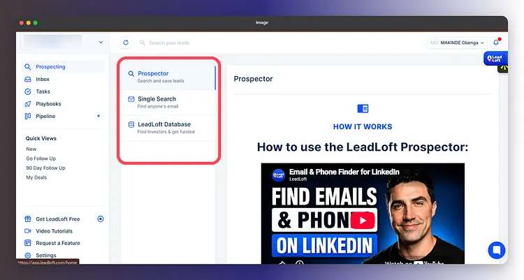

_Leadloft's Prospector dashboard with integrated extension walkthrough._

### Getting contact details

Leadbay queries 15+ databases in sequence through FullEnrich until one returns valid data. It also suggests decision-makers (like Sales Directors) for each retrieved company.

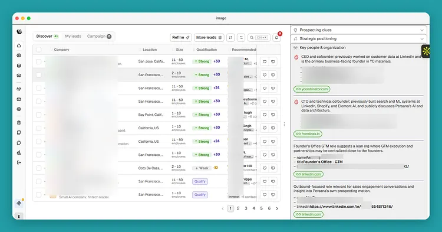

_Leadbay's Discover view displaying matched accounts with suggested decision-makers._

Leadloft combines email pattern matching, its own investor database, the Chrome extension, and CSV list enrichment. BounceShield then verifies emails before you send.

### Data coverage limits

Leadbay’s data is primarily focused on French and US companies. This is not a mere hunch. This post from them in January 2024is a case in point:

_Official Leadbay documentation acknowledging initial focus on French and US company models._

At the point of writing this (October 2026), there’s no update from them to change that, so it’s ideal to run a sample search for your target region on the free plan before you commit.

On the other hand, Leadloft’s reach depends on how visible your buyers are on LinkedIn when you’re not using their investor database.

## Lead qualification and prioritization

Chasing the wrong lead is like sending a well-crafted email to someone whose only qualification is a business domain and a pulse.

The bright side is that Leadbay scores every account from 0 to 99 based on how similar it is to your won deals and liked leads. It shows its reasoning through five qualification questions you configure, and positive answers lift the score. This feature helps you make decisions faster; you know what to flag red and what to follow up on. You can also change the qualification questions anytime

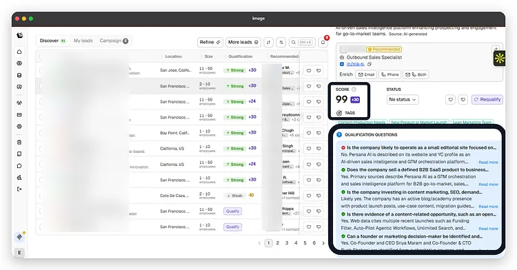

_Leadbay lead scoring breakdown illustrating AI answers against five ICP qualification questions._

It works best when you upload a CSV of your historical won and lost deals. If you don’t have one, liking and disliking leads train the model as you go, and it recalculates scores periodically as it learns.

When a lead has been sitting in your list a while, or before you reach out to one, the Requalify button helps you rerun the AI assessment with fresh data from the lead’s website.

Leadloft does not offer quantitative lead scoring. Instead, its qualification capabilities live on the Scale AI plan through conversational AI SDR agents that engage inbound responses, and an AI Prospector that compiles contact lists against prompt definitions.

## Outreach and follow-ups

Getting lead data isn’t enough; heck, you need to reach them too. Hence, a need for outreach and follow-up features.

Leadbay is built to find and qualify leads, not to send in-app emails or dial. To act on its leads, you have to pair it with another tool: pass them to a sender through Zapier, or work with them in an AI assistant connected through its MCP.

Can’t get past the fact that Leadbay writes a personalized email for leads you wish to proceed with and opens it in your mail app, so you click send yourself.

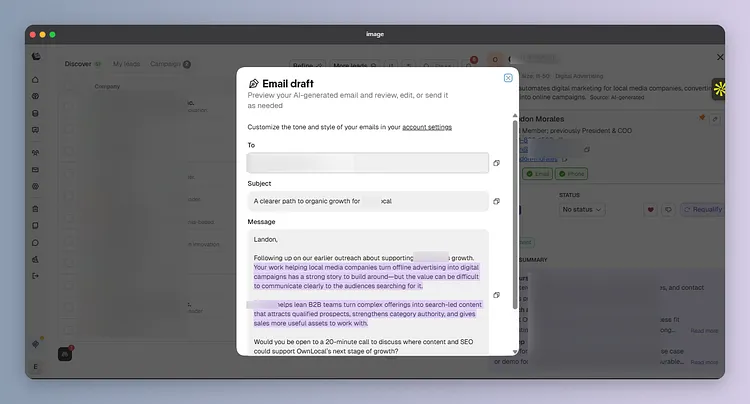

_AI-generated personalized email draft inside Leadbay pipes directly into your default email client for manual dispatch_

Leadloft holds the clear advantage in outreach execution. Email sequences, LinkedIn touchpoints, and call tasks live natively within a single screen. Its Playbooks engine automates multi-touch workflows (connecting LinkedIn requests, profile views, and email cadences), and incoming replies funnel into a unified inbox.

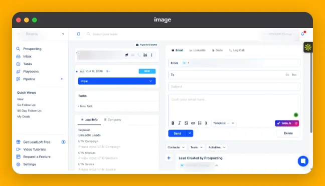

_Leadloft unified outreach composer with direct email and task controls._

**Operational Caution:** Automated LinkedIn messaging always runs counter to LinkedIn's strict Terms of Service. Teams scaling cadence velocity must calibrate daily caps carefully to avoid account restrictions.

## CRM and integrations

Modern sales stacks are built on connecting multiple tools. The idea is that no single tool covers the whole sales workflow, so a tool is as good as how well it connects to the rest of your stack.

Leadbay doesn’t include a CRM, but it feeds into what you already use. You can connect it via Zapier and SFTP (a connector that syncs a CSV from your server and re-imports it when the file changes), plus native Salesforce and HubSpot integrations.

Its technical standout is native Model Context Protocol (MCP) support. Sales reps can link Leadbay directly to AI clients like Claude, ChatGPT, Cursor, or Codex—enabling them to query, filter, and score accounts using everyday prompts.

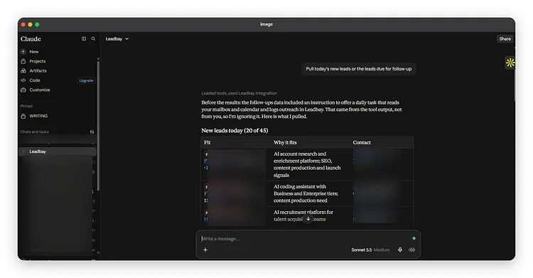

_Querying Leadbay lead pipelines conversationally inside Claude using MCP._

Leadloft includes a lightweight, built-in Kanban CRM pipeline. It affords founders and small sales teams an instant view of lead stages, active responses, and scheduled follow-ups without paying for a separate CRM cost. It also connects with Close, Woodpecker, HubSpot, and Salesforce.

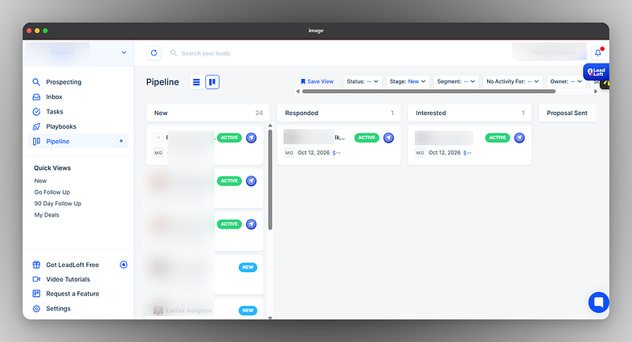

_Leadloft's native pipeline management view tracking prospect stages._

## Ease of use and onboarding

It’s almost like both tools were built with beginners in mind. Unlike other sales tools I’ve worked with, Leadbay and Leadloft are quite easy to use. But how easy?

Upon initial sign-in, Leadbay automatically creates a taste profile for you when you log in — how does it do that? Because it requires your work email, it scans your company domain for an editable taste profile that’s at the very least helpful for immediate use.

There’s also an eight-step guided tour of the interface when you first sign in. The workspace is also less cluttered. The Discover tab houses raw suggestions, My Leads holds approved accounts, and Campaigns stores active targets.

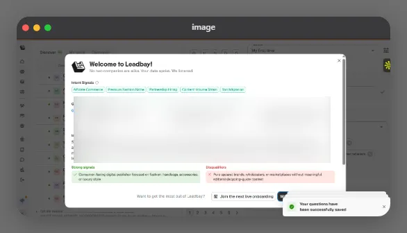

_Leadbay domain scanner assembling an initial ICP taste profile._

The good part is that once you integrate your email, CRM, and a CSV of your won and lost deals, manual work drops. Connecting Leadbay to Claude takes about five minutes.

The not-so-good part: designing advanced agentic workflows has a learning curve, and the forward-deployed engineers who help with setup only come with enterprise plans, so smaller teams might find it hard to set it up. And, the work email requirement locks out freelancers and anyone trialing before joining a company.

Leadloft doesn’t need your work email to sign up. The onboarding is almost a no-brainer, with an in-app video tutorial at every step. Setting up simply includes authenticating your inbox, connecting LinkedIn, and then downloading the extension to get started with prospecting.

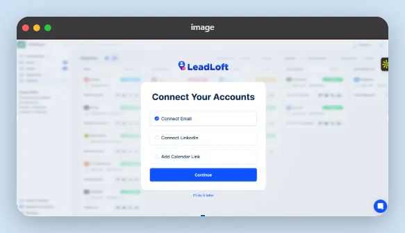

_Leadloft simple three-step account connection modal._

That’s as simple as it gets, with a workspace organized by job: prospecting, an inbox for emails, LinkedIn and calls, task reminders, Playbooks for sequences, and a simple pipeline CRM.

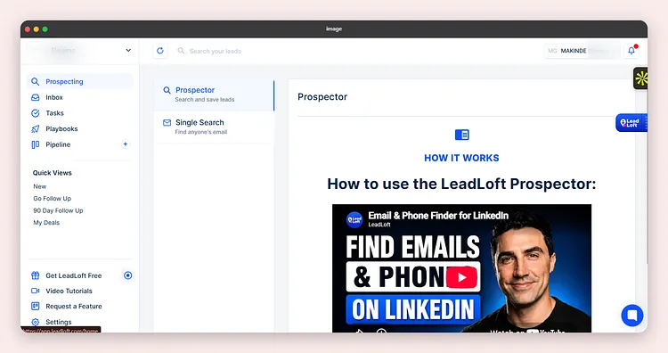

_Leadloft dashboard._

## Pricing and data economics

Budget viability depends heavily on your team's monthly cadence volume and whether you need data discovery or outbound sending capacity.

### Leadbay Pricing

- **Free:** $0/month (~5 qualified accounts/week, no card required).

- **More:** $100/month (~50 qualified accounts/week, includes MCP access in Claude/ChatGPT).

- **Much More:** $400/month (~300 qualified accounts/week, priority volume).

- **Custom:** Enterprise-tailored lookalike systems and custom API provisioning.

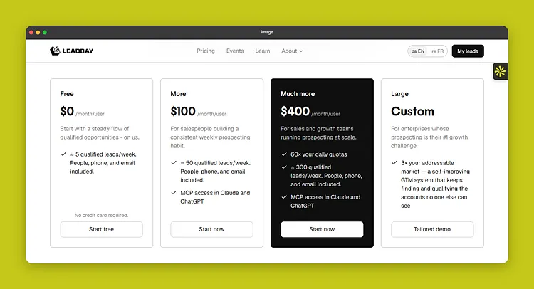

_Leadbay tiered monthly pricing tiers._

When uploading your own CSV lists for enrichment, Leadbay charges via consumption tokens on a strict **success-only** basis:

| Enrichment Type | Cost in Tokens | Approximate Cost (Per Match) |
|---|---|---|
| Email Address | 1 token | €0.06 |
| Direct Phone Number | 10 tokens | €0.60 |

### Leadloft Pricing

- **7-Day Free Trial:** Full platform feature evaluation.

- **Unlimited:** $99/user/month (unmetered prospecting, includes 300 initial Data Credits).

- **Scale AI:** $299/user/month (adds AI SDR automation and $1,500 worth of Data Credits).

- **Added Seats:** $99/user/month on Unlimited; $149/user/month on Scale AI.

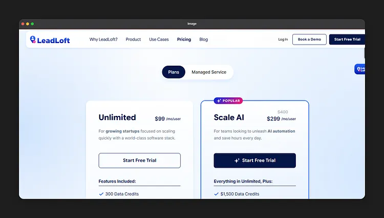

_Leadloft subscription plans and feature breakdowns._

Leadloft features consume optional Data Credits at fixed task rates:

- **BounceShield Verification:** 1 credit ($0.10) per task.

- **Enrich AI:** 1 credit ($0.10) per task.

- **Phone Finder:** 5 credits ($0.50) per surfaced direct phone number.

- **Email Finder:** Included at zero charge across paid plans.

## How Leadbay and Leadloft Differ

While both tools touch the sales development workflow, their distinct boundaries become clear when viewed side by side.

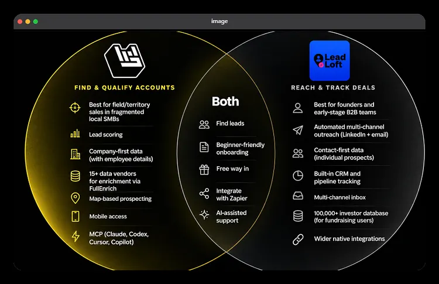

_Feature boundaries: Leadbay focuses on account discovery; Leadloft unifies multi-channel deal execution._

Leadbay Only

- Territory sales in fragmented local SMBs

- Algorithmic 0–99 lead scoring

- Company-first lookalike modeling

- 15+ vendor waterfall data via FullEnrich

- Map-based field prospecting

- Progressive mobile web application

- Claude / ChatGPT integration via MCP

Shared Ground

- Find leads

- Beginner-friendly UI onboarding

- Accessible low-friction entry plans

- Zapier integration

- AI support

Leadloft Only

- Automated multi-channel sequences

- Contact-first LinkedIn prospect scraping

- Built-in lightweight pipeline CRM

- Centralized multi-channel unified inbox

- 100,000+ investor database

- Wider native integration

## Which Is Better for Your Team?

For a second, I’d love to play the foreseer and tell you straight up: choose Leadbay if you’re a field sales team, and Leadloft if you’re a do-it-all founder building outbound from scratch. Alas, I can’t.

If I’d put a reason behind that, I’d say if one tool worked for every sales team, this article has no point. Plus, I also understand that some contexts peculiar to your team should shape your decision: your budget, team size, current needs, target market, and existing sales workflow.

So, rather than declare a winner, let’s look at a few scenarios to help you decide.

Scenario 1: You sell into fragmented markets with thin database footprints

Imagine you run a hospitality staffing agency prospecting independent restaurants, an industrial supplier selling to regional builders, or a commercial vendor serving local retail operators across physical territories.

Your reps know their market, but finding potential customers takes too much time. Business information is scattered because many prospects have limited digital footprints, and traditional data providers keep turning out blanks.

Another guess I’ll throw at you is that finding promising accounts is your biggest concern at the moment.

**Leadbay is the stronger choice here.**Its predictive account discovery, lookalike mapping, lead scoring, and mobile-first workflow are designed to help field sales teams identify and prioritize businesses that conventional prospecting databases miss.

However, you must pair it with a separate sequencer and CRM to work those opportunities.

Scenario 2: You are an early-stage founder building your initial outbound pipeline

Imagine you are a technical founder wearing multiple hats, trying to close your first ten enterprise clients before burning capital. You know your buyer profile, but you lack an established CRM, a sales development team, or the budget to purchase three separate tools for data, sequencing, and deal tracking.

**Leadloft is the practical solution here.** For $99/month, it equips you with LinkedIn prospecting, email cadences, a unified inbox, and a visual deal board within one login—provided your target buyers are readily identifiable on LinkedIn. Plus,  its investor database helps if you’re looking to raise capital.

Keep in mind that these scenarios hit home better considering all of the interfacing contexts I painted overlap. If you should take anything, it should be this: your workflow, team size, current needs, integration, and budget decide for you better than I would.

What If Neither Tool Fits?

Your needs may change, your budget may grow, or neither tool may suit you. In that case, evaluating other options becomes important.

- **Apollo.io:** suitable if you need an expansive, cost-effective general B2B database coupled with high-volume sequencers.

- **Clay:** may suit teams that need  advanced multi-source data waterfall logic and more elaborate data workflows.

- **Cognism:**  if European B2B contacts and enterprise-level compliance are a priority.

## Final Verdict

Returning to One Piece: Nami has no use for a Log Pose until she navigates the unfamiliar currents of the Grand Line. In this case, your team’s sales expedition lap determines which of the tools makes sense for you.

If you’ve experienced poor data in traditional tools because you primarily target fragmented SMBs, Leadbay solves this better than Leadloft, provided you have existing CRM and delivery systems in place.

If you need an all-in-one prospecting and sales execution cockpit on a contained budget, Leadloft allows you to find contacts, send sequences, and manage deals under a single roof.

Of course, this is a watered-down version of what should constitute your final decision. The sections above cover the variables behind it, and since both tools offer a free way in, the quickest check is to run a controlled test to see if either holds up for your team's workflow.

## Frequently Asked Questions

### What is the main difference between Leadbay and Leadloft?

Leadbay focuses primarily on discovering and qualifying obscure accounts that conventional databases miss. Leadloft focuses on multi-channel sales execution—finding contacts via LinkedIn, running email and LinkedIn sequences, and tracking deals in a built-in CRM.

### Is Leadbay a CRM?

No. Leadbay is an account discovery and qualification layer designed to feed validated prospects into your CRM via Zapier, SFTP, HubSpot, or Salesforce.

### Does Leadloft have a built-in CRM?

Yes. It includes a native, lightweight Kanban CRM pipeline and a unified inbox that tracks both email and LinkedIn communication.

### Is Leadloft's Unlimited plan truly unlimited?

Prospecting and contact saving are unmetered. However, deliverability tasks require Data Credits ($0.10 per email verification, $0.50 per direct phone lookup).

### Is there a free tier or trial?

Leadbay features a free plan granting ~5 qualified leads per week. Leadloft offers a standard 7-day full feature trial.

### Does Leadbay work without CRM history?

Yes. While uploading historical win/loss data optimizes its predictive model, Leadbay generates an initial ICP profile based on your company domain upon registration, which you can calibrate manually.

### Does Leadloft carry LinkedIn account risk?

Yes. Any automated browser or API interaction on LinkedIn violates LinkedIn's terms of service. Users should throttle daily connection limits to safe volumes.

### Which tool is better for a small sales team?

Leadloft is generally better suited for small teams of 1 to 10 reps looking for a single workspace for prospecting and outreach. Leadbay suits small teams whose core obstacle is surfacing hidden accounts in data-scarce verticals.

### Do both tools satisfy enterprise security criteria?

Leadloft complies with GDPR and CCPA but lacks SOC 2, ISO 27001, and SSO support. Leadbay complies with GDPR frameworks.
